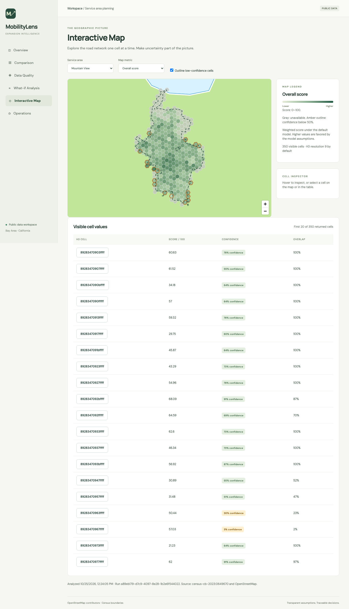
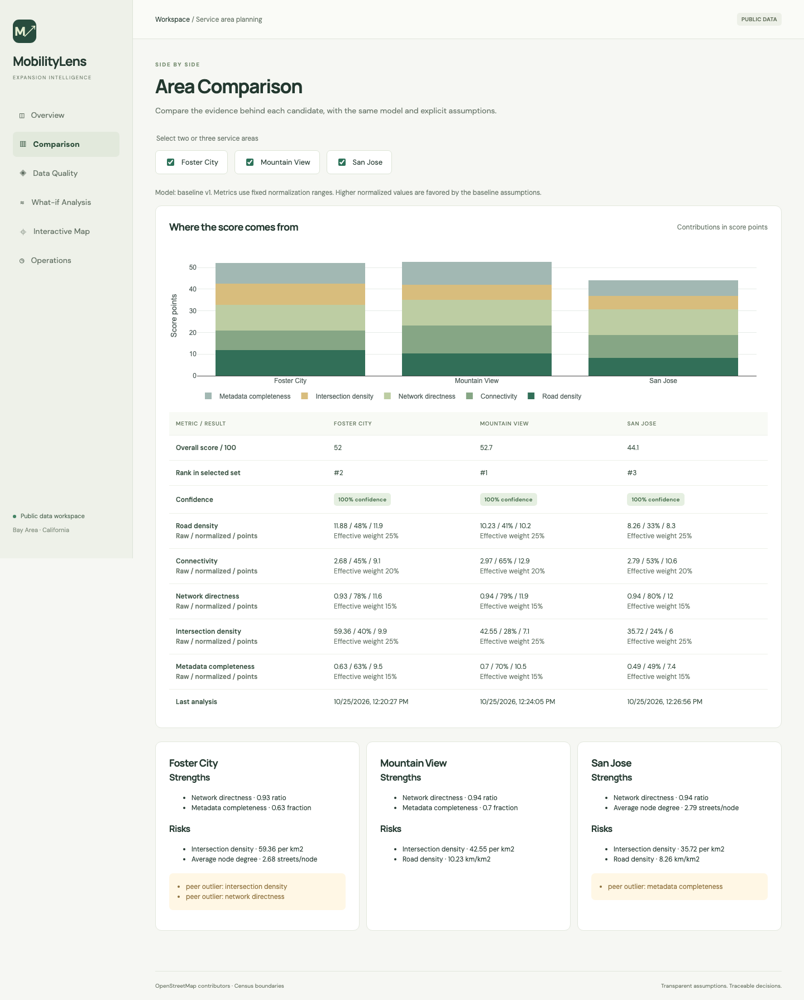
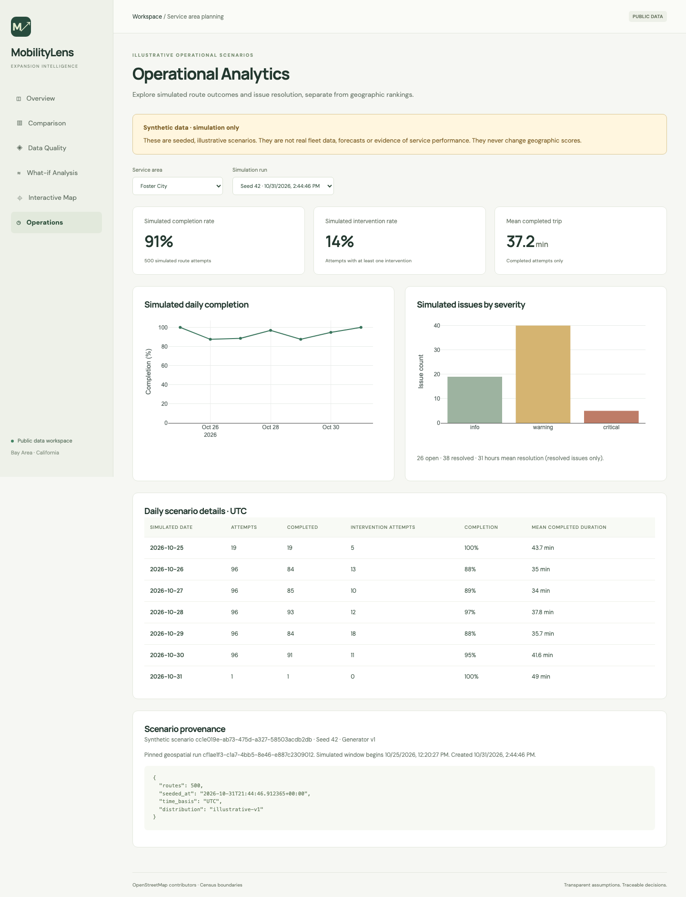
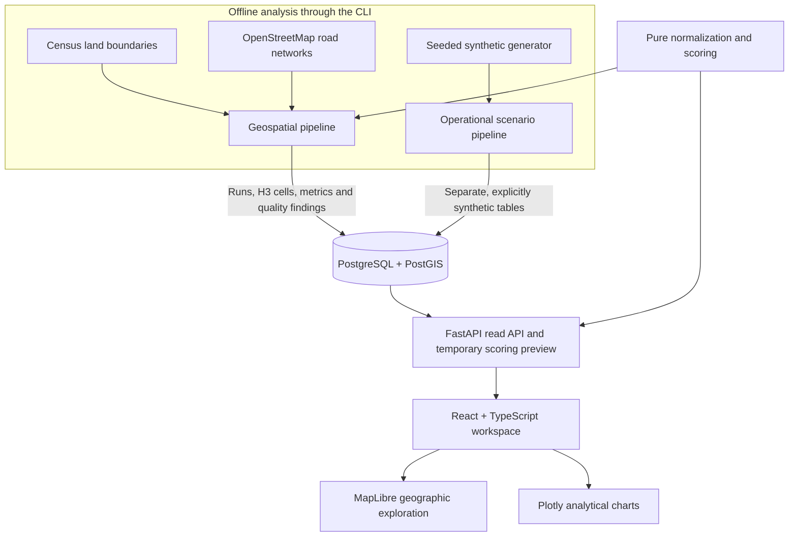

# MobilityLens

**Choose where a mobility service should expand—and explain why.**

MobilityLens is a full-stack decision-support workspace for comparing candidate service areas. It turns public road-network data into geographic metrics, transparent rankings, and visible data-quality signals, so an analyst can inspect the evidence and challenge the assumptions behind a recommendation.

[Watch the demo](docs/demo.webm) · [Decision walkthrough](docs/decision-walkthrough.md) · [Architecture](docs/architecture.md) · [MIT license](LICENSE)

## The use case

Imagine an operations team choosing between **Foster City, Mountain View, and San Jose** for its next service area. A single score is not enough: the team needs to understand the street network, compare strengths and risks, identify incomplete data, and see whether different priorities change the answer.

MobilityLens brings that workflow into one interface:

1. **Find the leading candidate** under a documented scoring model.
2. **Explore the geography** through a hexagonal H3 grid of local metrics.
3. **Compare the evidence** side by side, including score contributions and confidence.
4. **Challenge the priorities** with temporary scoring weights.
5. **Review the limitations** before making an expansion decision.

It is an analytical planning tool—not an autonomous-driving system or a validated forecast of service performance.

## See the workspace

### Executive overview

The overview brings together candidate rankings, the leading area, analysis timestamps, and the metrics behind its score.


<details>
<summary><strong>Interactive map — inspect local conditions</strong></summary>

Select an area and metric, inspect individual H3 cells, and highlight low-confidence regions. Gray cells indicate unavailable values; amber outlines identify low confidence. Requests are limited to the current map viewport.



</details>

<details>
<summary><strong>Area comparison — understand the tradeoffs</strong></summary>

Compare two or three areas using the same model. Review raw and normalized metrics, effective weights, score contributions, strengths, risks, and warnings.



</details>

<details>
<summary><strong>Operational analytics — explore clearly labeled simulations</strong></summary>

A separate Operations page shows seeded, reproducible **synthetic** route and issue scenarios: completion rates, intervention rates, trip duration, issue severity, and resolution time. These are illustrative generated outcomes, not observed fleet performance, and never affect geographic rankings.



</details>

| View                 | The question it answers                                                          |
| -------------------- | -------------------------------------------------------------------------------- |
| **Overview**         | Which candidate leads, and what supports its score?                              |
| **Interactive Map**  | Where do network conditions and confidence vary within an area?                  |
| **Comparison**       | How do two or three areas differ on the same metrics?                            |
| **Data Quality**     | What is missing, unreliable, or worth reviewing in the source data?              |
| **What-if Analysis** | Does the ranking change when our priorities change?                              |
| **Operations**       | What would operational reporting look like using explicitly synthetic scenarios? |

## How the scoring works

The baseline model uses five road-network metrics:

| Metric                | What it describes                                    | Weight |
| --------------------- | ---------------------------------------------------- | ------ |
| Intersection density  | Intersections per square kilometer                   | 25%    |
| Road density          | Drivable road length per square kilometer            | 25%    |
| Connectivity          | Average number of streets connected at a node        | 20%    |
| Network directness    | Straight-line distance relative to road-path length  | 15%    |
| Metadata completeness | Presence of road tags such as speed, lanes, and name | 15%    |

Raw values are normalized against fixed reference ranges and combined into a **0–100 score**. Every result retains its component values, weights, contributions, and analysis-run reference.

- **Missing is not zero.** Unavailable metrics stay unavailable; remaining weights are renormalized and confidence is reduced. Below 50% available weight, no score is returned.
- **Assumptions stay visible.** Higher values are favored by the baseline model. Weights and reference ranges are documented choices, not objective measures of service feasibility.
- **Confidence has limits.** It is a reliability signal, not a probability or a safety guarantee. Area confidence currently uses network sample size.
- **What-if changes are temporary.** Sliders always total 100%; the backend recalculates the ranking without saving those weights.

In the included public-data snapshots, Mountain View scores **52.68**, narrowly ahead of Foster City at **52.03**. Giving intersection density all the weight makes Foster City lead instead. That sensitivity is part of the decision, not something the interface hides. See the [worked example](docs/decision-walkthrough.md) and [scoring model](docs/scoring-model.md).

## Architecture



**Batch processing** loads boundaries, downloads or reuses cached road networks, builds H3 cells, computes metrics, checks quality, and records a versioned analysis run. Failures roll back the run's data while retaining an error record.

**The API** serves stored analysis results and calculates comparisons and temporary previews through one scoring implementation. HTTP requests never launch a city-wide OSM download.

**The frontend** presents the decision workflow, fetches cells for the visible viewport, and makes missing values and provenance accessible. Synthetic operational records remain separate from geographic scores throughout the database, API, and UI.

### Technology stack

| Layer                 | Technologies                                                                          |
| --------------------- | ------------------------------------------------------------------------------------- |
| Geographic processing | Python 3.12, GeoPandas, Shapely, OSMnx, H3, NumPy, Pandas                             |
| Backend and storage   | FastAPI, Pydantic, SQLAlchemy, Alembic, PostgreSQL/PostGIS, Typer                     |
| Frontend              | React, TypeScript, Vite, TanStack Query, MapLibre GL, Plotly                          |
| Verification          | pytest, Vitest, React Testing Library, Playwright, Ruff, MyPy, ESLint, GitHub Actions |

## Explore the implementation

```text
backend/
  app/          API, domain models, repositories, scoring and quality rules
  pipelines/    Geographic ingestion and seeded synthetic generation
  cli/          Seeding, analysis, simulation, recovery and diagnostics
  migrations/   Versioned PostGIS/database schema
  tests/        Unit, database integration and API contract tests
frontend/
  src/          Pages, shared components, API client and map layers
  e2e/          Browser workflows and demo recording
  tests/        Component tests and isolated browser fixtures
docs/           Architecture, assumptions, examples, screenshots and demo
```

The implementation has been checked locally with **250 backend tests**, **16 frontend tests**, and **6 browser tests**, alongside lint, formatting, type checks, and a production build. See [logs.md](logs.md) for the implementation history and verification scope.

For deeper reading: [data model](docs/data-model.md), [API contract](docs/api.md), [sample responses](docs/sample-responses/), [range review](docs/calibration.md), and [reliability/performance notes](docs/reliability.md).

## Data and license

The geographic examples use **OpenStreetMap contributors' data (ODbL)** and **US Census land-clipped boundaries**. Included geographic screenshots reflect stored analysis snapshots from **October 25, 2026**. Operational examples are generated, explicitly labeled synthetic data; no proprietary fleet data is used.

The project source code is available under the **[MIT License](LICENSE)**, copyright **2026 Kenil Gopani**. Third-party datasets and dependencies retain their own licenses.

## Quick local setup

**Requires:** Python 3.12, [uv](https://docs.astral.sh/uv/), Node.js 22+, and Docker Desktop running. Start from the repository root.

**1. Start the database and prepare the backend.**

```bash
docker compose up -d --wait db
cd backend
cp ../.env.example .env
uv sync --frozen
uv run alembic upgrade head
uv run python -m cli seed-service-areas
uv run python -m cli seed-metric-definitions
uv run python -m cli seed-scoring-model
uv run python -m cli analyze-all
uv run uvicorn app.main:app --reload
```

The first analysis downloads public road data and can take several minutes; subsequent runs reuse cached responses.

**2. In another terminal, start the frontend from the repository root.**

```bash
cd frontend
cp .env.example .env.local
npm ci
npm run dev
```

**3. Open [localhost:5173](http://localhost:5173).** API documentation is at [localhost:8000/docs](http://localhost:8000/docs).

Optional: populate the Operations page by running `uv run python -m cli simulate-area foster-city --seed 42 --routes 500` from `backend/` in another terminal. This generates a clearly labeled synthetic scenario.
